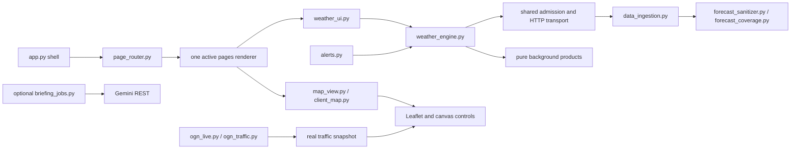

# Architecture diagnostic and refactor — 8 November 2026

The dashboard now reads weather through one process-wide engine. HTTP work,
forecast completion, chart preparation, page rendering and live aircraft
reception have separate responsibilities. A failed provider cannot prevent a
map or navigation control from mounting.

## Audit scope and findings

The reproducible [source inventory](architecture-inventory.json) covers every
first-party Python and JavaScript source, including scripts and tests. Run
`python scripts/audit_architecture.py` to regenerate imports, cache decorators,
session-state keys and networking call sites. Vendored Leaflet is excluded.
The detailed review followed all forecast consumers, browser controls, OGN
receivers, notification entry points and their regression tests. This repository
uses `alerts.py` plus `watchdog_weather.py`; it has no `soaring_watchdog.py`.

| Root problem | Structural correction |
| --- | --- |
| Regional, national, corridor, inspector, local bot and radar readers owned different clients/caches. Airfield hover also fetched Open-Meteo directly from JavaScript. | `weather_engine.py` owns forecast scheduling and the shared HTTP transport. Browser airfield hover uses the selected forecast payload, with sample distance and retrieval time. |
| A healthy primary caused whole-domain requests for all three models. Independent retries and pacing sleeps multiplied latency. | Request the selected model first; fetch donors only for incomplete coordinates. One HTTP attempt, a 3.5-second socket timeout, shared weighted admission and `Retry-After` cooldown, with no retry sleeps. |
| A partially successful large-grid retry could repeatedly spend its quota on the first geographic chunks. | Eight-coordinate jobs have independent verified-result caches. Aggregate requests reuse finished chunks and resume only unfinished work. |
| Raw HTTP 200 JSON could be cached before schema/coverage validation. Failed national futures remained pinned for a full cycle. | Raw weather HTTP caching is disabled. Empty/partial/error results never enter the verified cache. Retry state is separate and can recover within the same cycle. |
| The completion test checked soaring hours, while cache admission checked overnight fields too. A real ICON response exposed this mismatch. | Both use the same `forecast_sanitizer.has_core_coverage` contract. An overnight core gap also requests donor support before admission. |
| A cold regional request returned before map construction, hiding otherwise usable controls. | The page shell, five day slots and map mount immediately. Background fragments update the products when ready. |
| One very large application function mixed all seven pages, weather scheduling, charts and map construction. | `app.py` is the shell; `page_router.py` imports exactly one renderer from `pages/`. `weather_ui.py` handles nonblocking reads and `map_view.py` builds maps/charts. There are no `st.tabs()` wrappers. |
| Wave calculations, task contour preparation and optional probe preparation could occupy the UI thread on a cold product. | Pure products have separate background workers. Task and wave controls mount with transparent pending layers; a completed product replaces them. |
| Bot/optimiser/route-analysis actions assumed a synchronous forecast return. Optional Gemini discovery could block navigation and retain a failed connection. | Actions keep explicit pending state and resume after their jobs finish. Optional Gemini discovery/generation use separate workers; failed discovery is not cached as a connection. |
| Weather date/model changes unnecessarily rebuilt the independent OGN document. | OGN rendering receives no forecasts and is keyed by reference/asset versions, not weather selections. |
| Old grid slices and overlapping page-state caches survived reruns. | A versioned session migration removes the known obsolete keys. Saved daily tasks, chat and preferences survive. Refresh invalidates weather TTLs, not all application caches or active jobs. |

CAPE was already optional in the physical rating calculation, and the existing
moisture code already contained useful derivations. Those were retained and
centralised, rather than replaced with arbitrary zeroes. Strict route/alert
checks remain where evidence is required to claim an achievable flight.

## Ownership

### Forecast and cache contract

- Request identity is coordinates, model and optional field selection. Selected
  day/hour, active page and task UI state are not forecast cache keys.
- Every request contains the whole requested horizon, including the past hours
  needed to assess today's morning window. A verified chunk lasts 30 minutes.
- Concurrent identical jobs share a future. Concurrent identical HTTP requests
  also share their in-flight result. Successful chunks survive failed refreshes.
- Only parsed, completed core fields and all requested locations admit a forecast
  to the verified cache. Compact products validate their requested core fields.
  Optional CAPE/upper-level gaps remain explicit, not zero-filled.
- An incomplete attempt is transient retry status, normally retried after 15
  seconds. HTTP cooldowns and admission limits still apply. Neither a page change
  nor Refresh can bypass a running request or a provider cooldown.
- The regional and national adapters retain a previous verified product when a
  refresh fails. Retrieval times and supporting-model provenance are preserved.
- Day summaries, contours and chart caches are derived products keyed by forecast
  identity. A pending/empty product cannot hide a later successful forecast.
- Full-domain wind payloads always have a deterministic 168-node, 120-hour,
  six-altitude schema over 49.5–61°N, −11–2.5°E. Missing values remain null.
  Supported spatial wind estimates disclose their nearest-source distance.

The shared gate applies within one Python process. It cannot coordinate other
customers on Streamlit Cloud's shared IP, or guarantee that a free upstream
service never returns HTTP 429. Quotas can spread a national refresh across
multiple admission windows; the interface does not wait for that work.

### Completion and physics

Model-suffixed fields are normalised before completion. Native values and known
zeroes are preserved. Donors are aligned by coordinate, UTC hour and units;
borrowed fields retain provenance. Humidity uses temperature/dewpoint evidence
and Magnus conversion. Upper wind interpolation operates on vectors and uses
bracketing pressure levels, avoiding angle-wrap and underground-wind mistakes.

`400 × (T − Td)` estimates condensation height in **feet AGL**. It is not a
boundary-layer depth in metres. Missing mixing depth uses the existing
bracketed dry-parcel intersection with the sounding. Radiation already enters
the thermal heat-flux calculation; an arbitrary extra solar boost would double
count heating. Unsupported rain, CAPE or mixing depth is not fabricated.
The Duo Discus polar and single circling-sink deduction remain unchanged.

A complete provider outage leaves the five dated card slots, terrain map,
controls, task editing and exports usable. Values are pending or last verified;
there is no fabricated synoptic forecast or false “8/8”/star-rating claim.

### Page and service boundaries

Weather alone can start the national grid or enable the Point Forecast Probe.
Task planning uses regional/corridor weather and can read an already-completed
national grid. Help, the bot's initial view, Data quality and OGN navigation do
not start weather requests. Explicit bot questions may request their local sector.

Wind always exposes Streaming Wind, Wind Barbs and Wind Off, including with an
empty grid. The canvas keeps black 2.4 px arrows and arrowheads, with no colour
haze. BGA references start off on weather/traffic views and are a local toggle.
Point probe clicks and wind altitude changes remain browser operations.

OGN retains its independent APRS receiver, cookie-aware XML mirror sessions,
DDB resolver and age/privacy filters. There are no synthetic production aircraft.
The tests use clearly isolated synthetic packets. No notification delivery was
performed during this refactor's verification.

## Verification

All **339 unit tests** passed. Run the full suite with
`python -m unittest discover -s tests -v`. Browser checks
use `requirements-test.txt`, followed by `python -m playwright install chromium`
and `python scripts/run_architecture_checks.py`. CI runs the unit suite and the
healthy/429/timeout browser scenarios, retaining timing reports and screenshots.

Regression coverage includes shared-request deduplication, interrupted chunk
recovery, failed-cache rejection, cooldowns, all three model parsers, five-day
coverage, session migration, lazy routing, missing-payload controls, wind glyphs,
probe/cloud physics, OGN age/privacy behaviour and all task export formats.

Measured in this workspace:

- Healthy, forced 429 and slow-timeout sessions: all seven pages opened with no
  Python startup exceptions or JavaScript errors; changing day did not add HTTP
  requests. Outage fixtures keep the fault active for the full browser scenario.
- Warm server page renders: 6–327 ms in the isolated CI scenarios, including
  the first completed task-overlay document. The final recorded-data browser's
  true click-to-ready medians were 203–410 ms across all seven pages.
- Wind display switches: below 4 ms, zero server events; 3,600 coordinate/hour/
  altitude checks passed. Pixel checks found black strokes and no blue haze.
- Probe draws: 20–35 ms in healthy/outage sessions. Cloud-family scene checks
  passed, including missing moisture, clear skies and structured cloud forms.
- Live Open-Meteo: UKMO, ICON and ECMWF each returned five 8/8 soaring-hour days
  at the checked location. The UKMO sounding disclosed ECMWF/parcel support.
- The real watchdog dry run exited 0 in 7.3 seconds; no messages were sent.

These are measured tests, not a promise of identical timing on every device.
Cold imports, first-time terrain/geometry preparation, raster downloads and
provider completion have separate costs. Cold wave/task products now prepare
in the background so those costs do not become a synchronous weather wait.
